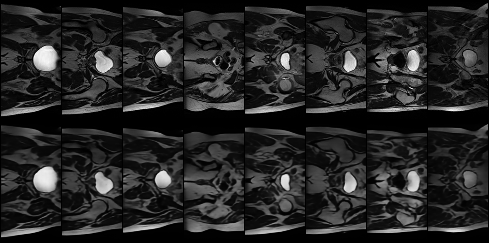
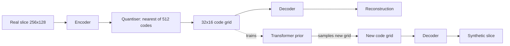
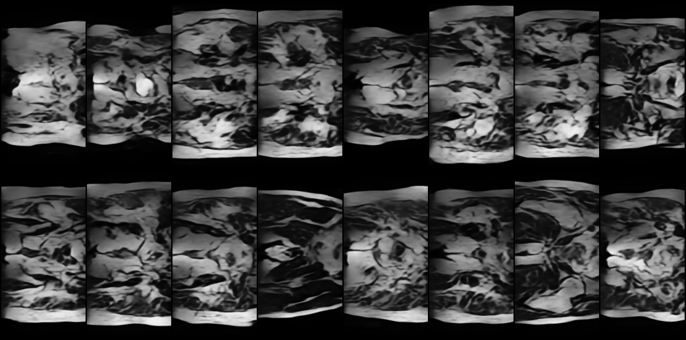
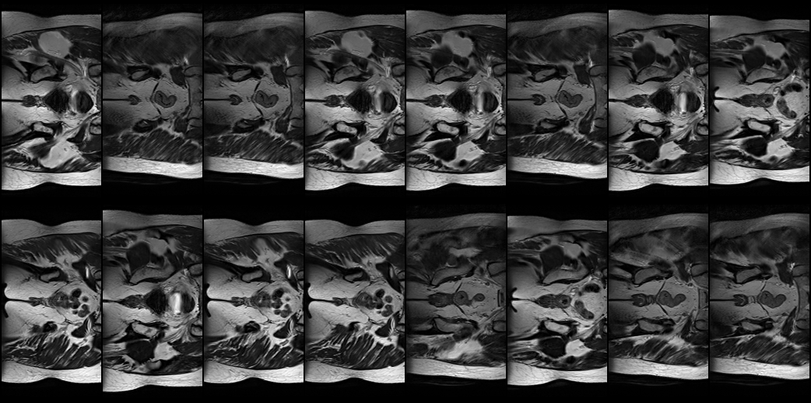
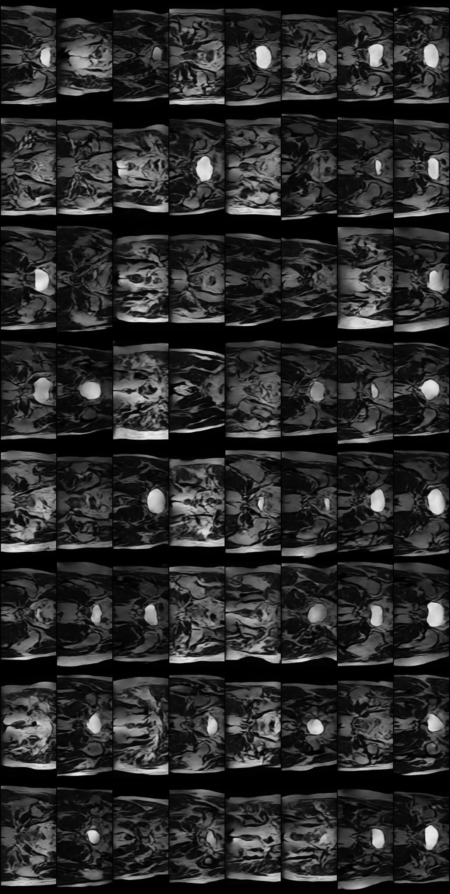
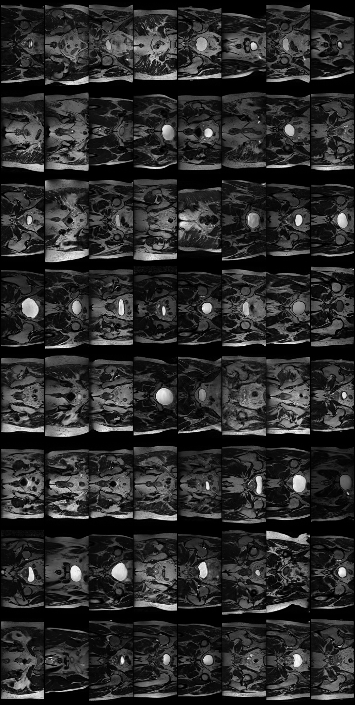
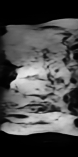
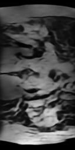
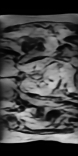

# Synthetic Hip-MRI Slices with a VQ-VAE and an Autoregressive Code Prior


*Top row: real test slices. Bottom row: their VQ-VAE reconstructions (test SSIM 0.856 over all 540 test slices).*

---

## 1. Problem and algorithm

**Problem.** Sharing real patient MRI is restricted by privacy rules, so a synthetic cohort that looks like
real anatomy but is not a copy of any patient would be valuable for data augmentation and software testing.
A generator is only useful if it is (a) sharp enough to be recognisable, (b) varied enough to cover the
population, (c) not memorising training scans and (d) anatomically plausible. This project builds a generator for
256x128 single-channel pelvic MRI slices from the HipMRI Study (prostate cancer radiotherapy, 2D NIfTI slices) and audits it on exactly those four questions.
The brief requires reconstruction SSIM > 0.6 on the test set, measured strictly on test-set reconstructions.

**Algorithm (VQ-VAE + code prior).** A Vector-Quantised Variational Autoencoder (van den Oord et al., 2017)
compresses each slice into a 32x16 grid of integers. Each integer indexes one of 512 learned 64-dimensional
codebook vectors, so an image becomes a short "sentence" of 512 discrete tokens. The decoder rebuilds the image
from the codebook vectors those tokens point to. A VQ-VAE only reconstructs, so a second model, a causal
transformer (the *code prior*), is trained on the token grids of the training images. It reads the grid in raster
order and learns the probability of each token given the tokens before it. New images are produced by sampling a
new grid token by token and decoding it.

**How it works.**
1. *Encoder*: three stride-2 convolutions and two residual blocks reduce a 1x256x128 image to a 64x32x16 feature map.
2. *Quantiser*: every feature vector is replaced by its nearest codebook entry. The codebook is updated by an
   exponential moving average of the vectors assigned to it, is initialised from real encoder outputs, and has a
   dead-code reset to prevent codebook collapse. Gradients pass through the non-differentiable lookup with the
   straight-through estimator (Bengio et al., 2013). A commitment loss (weight 0.25) keeps encoder outputs near their codes.
3. *Decoder*: mirrors the encoder and ends in a sigmoid (output in [0, 1]).
4. *Loss*: `L1 + (1 - SSIM) + commitment`, which optimises the metric the project is judged on directly.
5. *Prior*: 6-layer, 8-head, 256-wide transformer (5.0 M parameters) with learned row and column position
   embeddings, trained with cross-entropy and dropout 0.1. Sampling uses temperature 1.0.



**Baseline.** A convolutional VAE (14.0 M parameters, 128-dimensional continuous latent, MSE + KL with KL warm-up) is the baseline.

---

## 2. Repository layout and how to run

| File | Purpose |
|---|---|
| `dataset.py` | Reads the NIfTI slices, filters off-size files, scales each image to [0, 1], builds the DataLoaders |
| `modules.py` | `VAE`, `VectorQuantizer`, `VQVAE`, `CodePrior` (torch only, no numpy) |
| `train.py` | Training for `vae`, `vqvae` and `prior`; saves best checkpoints, histories and training curves |
| `predict.py` | Evaluation and audit for `vae` and `vqvae`; writes figures and `metrics.json` |
| `verify_extras.py` | Resource profile (VAE memory, inference latency) and an SSIM cross-check against scikit-image |

Run everything from the project root, because `data/` is a relative path. The reported results come from these commands
(seed 0 is the main run; seed 1 is a repeat with `--seed 1` and `_s1` output folders):

```powershell
python train.py vae   --epochs 50 --out models/final_vae
python predict.py vae --checkpoint models/final_vae/vae_best.pt --out results_final
python train.py vqvae --epochs 40 --vae_ref 0.491 --out models/final_vqvae
python train.py prior --vqvae models/final_vqvae/vqvae_best.pt --epochs 30 --out models/final_prior
python predict.py vqvae --vqvae models/final_vqvae/vqvae_best.pt --prior models/final_prior/prior_best.pt --vae models/final_vae/vae_best.pt --settings 1.0:0,0.8:50 --out results_final
python verify_extras.py profile --vae models/final_vae/vae_best.pt --vqvae models/final_vqvae/vqvae_best.pt --prior models/final_prior/prior_best.pt
python verify_extras.py ssim --vqvae models/final_vqvae/vqvae_best.pt
```

---

## 3. Dependencies and reproducibility

Environment: Windows, conda environment `torch`, NVIDIA GeForce RTX 5060 Ti (8 GB), NVIDIA driver 610.88, PyTorch built for CUDA 13.2
(`nvidia-smi` reports CUDA 13.3 driver support).

| Package | Version |
|---|---|
| Python | 3.14.8 (Anaconda) |
| torch | 2.14.1+cu132 |
| torchvision | 0.29.1+cu132 |
| nibabel | 5.4.2 |
| numpy | 2.5.3 |
| matplotlib | 3.11.2 |
| tqdm | 4.70.1 |
| scikit-image (only for `verify_extras.py ssim`) | 0.26.0 |

Install the packages in a fresh environment with the CUDA build of PyTorch that matches your driver, then `pip install nibabel matplotlib tqdm`
(and `scikit-image` for the SSIM cross-check). The exact versions above are also pinned in `requirements.txt`
(`pip install -r requirements.txt`; install `torch` and `torchvision` first from the PyTorch index that matches your CUDA driver, see the comment in that file).

**Reproducibility.**
- All scripts take `--seed` (default 0), which seeds PyTorch initialisation and noise; `predict.py` also seeds NumPy.
- The sample grids use a fixed sampling seed, so the same 64 images are produced on every run (no cherry-picking).
- Real-image subsets (PCA reference, diversity) are drawn with seeded generators. For the seed-1 repeat, `predict.py` kept `--seed 0`, so the
  evaluation subsets and the sampling noise stream are identical and only the trained models differ.
- cuDNN is **not** forced into deterministic mode, so bit-identical weights across machines or reruns are not guaranteed.
  Two independent training runs (seeds 0 and 1) agree closely (section 6.1), which is the evidence offered for reproducibility.
- All checkpoint selection uses the validation split only. The test split is scored once, at the end, with the selected checkpoint.
- Every checkpoint stores its constructor configuration, and every history file stores the command-line arguments used.

---

## 4. Data and pre-processing

**Data.** The HipMRI Study for prostate cancer radiotherapy: 2D prostate MRI slices (`keras_slices_data` folder) for 2D tasks, and 3D MRI data for 3D tasks,
covering 38 patients with 211 3D MRI volumes (MRIs in `semantic_MRs`, segmentations in `semantic_labels_only`). The body outline, bone, bladder, rectum and prostate
were segmented in 3D by an MR physicist with more than 10 years of experience. This project uses only the 2D slices, stored as `.nii.gz`, shape 256x128, float32,
in three pre-made folders (`keras_slices_train`, `keras_slices_validate`, `keras_slices_test`); the segmentation labels are not used.
The data was taken from the University of Queensland's Rangpur HPC (`rangpur.compute.eait.uq.edu.au`), path `/home/groups/comp3710/HipMRI_Study_open/keras_slices_data`.
File names such as `case_004_week_0_slice_0` identify the patient case, the scan week and the slice.

**Pre-processing.**
1. *Size filter.* A few scans (for example `case_019_week_1`) have a 256x144 matrix. Cropping or resizing them would cut or distort
   anatomy, so files not exactly 256x128 are skipped (header check): 60 of 11,460 training files were dropped; none were dropped from validation or test.
2. *Per-image min-max scaling to [0, 1].* Removes scan-to-scan brightness differences and matches the sigmoid decoder output.
   Blank slices map to 0 (a small epsilon avoids division by zero).
3. *No augmentation.* The slices are spatially registered, and an earlier experiment with random shifts made results worse, so none is used. Flips would swap left and right anatomy.
4. The training DataLoader shuffles and drops the last incomplete batch (11,400 files -> 11,392 images per epoch).

**Splits and justification.**

| Split | Patients | Files used | Role |
|---|---|---|---|
| Train | 31 | 11,400 | fit weights (and the prior's token statistics) |
| Validation | 4 | 660 | choose checkpoints (best validation SSIM for the VQ-VAE, lowest validation cross-entropy for the prior, lowest validation loss for the VAE) |
| Test | 3 | 540 | final, single scoring; all reported reconstruction SSIM |

- The provided folders split by **patient case**, not by slice. Neighbouring slices of one patient are almost identical, so a random
  slice-level split would leak near-duplicates into the test set and inflate every metric. `predict.py` checks this explicitly:
  the case IDs shared between train/validate/test are **none** (`split_overlap_by_case` in `metrics.json`, empty in both runs. File can be found in `images/results_final/final_vqvae/metrics.json`).
- Validation images come from different patients than training images, which makes the validation curve an honest guard against
  overfitting and against the prior memorising training grids. The prior's validation loss does turn upward after epoch 12 (seed 0) and 18 (seed 1)
  while its training loss keeps falling, and the saved checkpoint is the one before that.
- The test set is never used to select a model, so its SSIM carries no selection bias. It is, however, only **3 patients** (540 slices), so the estimate has
  patient-level variance that the slice count hides; the validation set used to choose checkpoints is only 4 patients. The split (31 / 4 / 3 patients, about 82 % / 11 % / 8 %) is the one provided with the dataset and
  was kept as given so results are comparable with other work on it; it was not re-drawn to be larger or more balanced.
- Because the test and validation sets are so small, a random subset of **training** slices (many patients) is the reference for the Fréchet and coverage metrics (section 6.1).
  Using the 3 test patients as the reference makes the k-NN balls tiny and coverage reads near zero for everything.

References for methods: Kingma & Welling (2014); van den Oord et al. (2017); Wang et al. (2004) for SSIM.

---

## 5. Example inputs, outputs and plots

**Input:** a `(1, 256, 128)` float slice in [0, 1]. **Outputs:** its reconstruction (same shape), its 32x16 integer code grid,
or a newly sampled grid decoded to a `(1, 256, 128)` image.

| Figure | File |
|---|---|
| VQ-VAE training curves (loss, SSIM vs 0.6 target and VAE baseline, PSNR, codebook perplexity) | `images/training_curve/vqvae_training_curves.png` |
| Prior training curves (cross-entropy and perplexity, train vs validation) | `images/training_curve/prior_training_curves.png` |
| VAE training curves | `images/training_curve/vae_training_curves.png` |
| Test reconstructions (real on top, reconstruction below) | `images/results_final/final_vqvae/test_reconstructions.png` |
| Worst test reconstructions | `images/results_final/final_vqvae/worst_reconstructions.png` |
| Reconstruction SSIM histogram | `images/results_final/final_vqvae/test_ssim_hist.png` |
| Uncurated samples, T=1.0 (first 64, fixed seed) | `images/results_final/final_vqvae/samples_T1.0_k0.png` |
| Interpolation (generated image blended into its nearest training scan) | `images/results_final/final_vqvae/interpolation_T1.0_k0.png` |
| Codebook usage | `images/results_final/final_vqvae/code_usage.png` |
| Most outlying generated images (failure autopsy) | `images/results_final/final_vqvae/worst_generated_T1.0_k0.png` |
| Most outlying real test slices (control) | `images/results_final/final_vqvae/worst_real_test.png` |
| Generated image next to its closest training scan | `images/results_final/final_vqvae/closest_to_train_T1.0_k0.png` |
| VAE samples | `images/results_final/final_vqvae/vae_samples.png` |

---

## 6. Investigation of the Open Research Dilemma

*Question: is the generated cohort safe to use, non-memorised and clinically plausible?*

Every model was trained twice (seed 0 and seed 1) with identical settings. Values are written **seed 0 / seed 1**. Seed 0 supplies all figures.

### 6.1 Quantitative benchmark against the baseline (identical splits)

Both models are scored by the same `ssim` function, on the same 540 test slices, with checkpoints chosen on the same validation split.

**Reconstruction (the project's SSIM > 0.6 requirement).**

| Metric (test set) | VAE baseline | VQ-VAE | Target |
|---|---|---|---|
| Reconstruction SSIM, mean | 0.491 / 0.490 | **0.856 / 0.856** | > 0.6 |
| Reconstruction SSIM, worst test slice | not recorded | 0.803 / 0.800 | |
| Fraction of test slices above 0.6 | not recorded | 100 % / 100 % | |
| Reconstruction PSNR (dB) | 20.50 / 20.29 | **27.23 / 27.19** | |
| Training-set SSIM (generalisation gap) | 0.573 / 0.575 | 0.840 / 0.839 | |
| Codes used by training images / perplexity | n/a | 512/512, 417 / 423 | |

- The VQ-VAE clears the 0.6 target by a wide margin on every one of the 540 test slices. The VAE misses it.
- The VAE shows a clear train/test gap (0.57 vs 0.49), i.e. it generalises worse. The VQ-VAE's test SSIM (0.856) is slightly *higher* than its training SSIM (0.840),
  so there is no sign of overfitting. The test slices form a single peak (0.80 to 0.91, no low tail, `test_ssim_hist.png`), so the 0.856 mean is not produced by a few easy slices.
  The small test-over-train difference is most likely patient variation (only 3 test patients), but I did not check this per patient.
- The VAE PSNR in `train.py`'s console (20.03 / 19.96 dB) differs from the table because training-time evaluation samples z at random; `predict.py` decodes the mean `mu`, which is the fairer reconstruction.
- SSIM cross-check: on 100 evenly spaced test slices this project's SSIM gives 0.8524 and scikit-image's 7x7 uniform SSIM gives 0.8481 (largest per-image difference 0.0064).
  The small offset is expected (scikit-image averages only interior pixels; this implementation pads the border).
- High SSIM does not mean sharp. The VQ-VAE reconstructions reach SSIM 0.856 but have only about a third of the real fine-detail energy (Laplacian ratio 0.32, section 6.3), and the brief asks for a "reasonably clear" image. The target is met; sharpness is the model's main weakness.
- The SSIM used is a uniform 7x7 window, not the Gaussian 11x11 of library implementations, so absolute values differ slightly from library SSIM.

**Generation quality** (256 generated images per setting; PCA-50 feature space, so **not** comparable to published FID; reference = 500 random training slices).

| Metric | VAE samples | VQ-VAE + prior, T=1.0 | VQ-VAE + prior, T=0.8, top-k 50 | Real-data floor | Real unseen test slices |
|---|---|---|---|---|---|
| Fréchet distance (lower is better) | 112.5 / 111.3 | **47.2 / 40.1** | 93.2 / 70.3 | 21.3 | 169.8 |
| k-NN precision | 0.969 / 0.965 | 0.949 / 0.961 | 0.938 / 0.945 | 0.965 | 0.887 |
| k-NN coverage | 0.624 / 0.700 | **0.816 / 0.816** | 0.722 / 0.698 | 0.858 | 0.292 |
| Pairwise SSIM of samples (real = 0.248) | 0.412 / 0.438 | **0.237 / 0.231** | 0.289 / 0.286 | | |
| Samples beyond the real 99th-percentile outlier score | 0 % / 0 % | 2.3 % / 4.7 % (6 / 12 of 256) | 10.5 % / 8.2 % (27 / 21 of 256) | 1 % by definition | |
| Samples with a training neighbour at SSIM > 0.6 | 0 % / 0 % | 0 % / 0 % | 0 % / 0 % | | 0 % |
| Mean SSIM to nearest training image | not recorded | 0.351 / 0.355 | 0.398 / 0.413 | | 0.331 (real unseen) |

How to read it:
- *Mode collapse:* at T=1.0 the generated images are as varied as real ones (pairwise SSIM 0.237 / 0.231 against 0.248 real) and all 512 codes appear in the
  samples. The VAE is much less varied (0.41 / 0.44): its samples all look like the same blurry average.
- *Fidelity:* the VQ-VAE is far closer to the real data than the VAE (Fréchet 40-47 against 111-112; coverage 0.82 against 0.62-0.70) but still above the 21.3 that other real training slices reach.
  These are distances in a coarse 50-component PCA space, so they say the samples have the right overall brightness layout, not that fine anatomy is right; the visual check in section 6.3 is stricter.
- *Precision is not informative here.* The blurry VAE scores 0.97, because a smooth average image falls inside some real image's neighbourhood. Fréchet distance and coverage separate the models; precision does not.
- *Temperature:* T=1.0 beats T=0.8 / top-k 50 on Fréchet distance, coverage, diversity and outlier rate. The lower-temperature samples look cleaner by eye but are less varied and contain more outliers, so T=1.0 is used throughout.
- *The "real unseen test slices" column is not a target.* Real slices from unseen patients score *worse* (Fréchet 169.8, coverage 0.29) than the generated images against a training-slice reference.
  That reflects patient-to-patient shift (the test set has few patients), not poor test data. It also means the generator reproduces the *training* population more closely than a new population would be,
  so a synthetic cohort from this model represents the training patients, not patients in general.
- *Seed-to-seed spread.* The two runs agree closely on reconstruction (SSIM 0.8564 vs 0.8559). Generation metrics move more (Fréchet 47.2 vs 40.1; outlier count 6 vs 12 of 256), which is
  the size of change expected from sampling only 256 images. Conclusions are drawn only where the gap is far larger than that spread (VQ-VAE vs VAE; T=1.0 vs T=0.8).

**Memorisation.**
- No generated image has a training neighbour with SSIM above the 0.6 copy threshold, in either run or setting. A true copy would score close to 1.
- Generated images are slightly closer to the training set than real unseen patients are: mean nearest-training SSIM 0.351 / 0.355 against 0.331, 95th percentile 0.435 / 0.462 against 0.397,
  and a pixel-distance ratio (generated-to-train over generated-to-test, equal-sized references) of 0.91 / 0.91.
  The blurry VAE, which cannot reproduce fine detail, shows a similar ratio (0.94 / 0.93 on its own run), which points to training-population affinity rather than copying, but this is not proof.
- Not tested: a membership-inference attack, or near-copies that are shifted or deformed. This audit therefore shows **no evidence of copying**; it does not prove privacy.

**Prior training** (cross-entropy, nats per code, lower is better): test 4.183 / 4.243 (perplexity 65.6 / 69.6 of 512), best epoch 12 / 18; the model starts to overfit after that,
so the checkpoint is chosen by validation loss.

### 6.2 Resource profile

RTX 5060 Ti (8 GB, about 3 GB in use by Windows). Seed 0 / seed 1 where recorded.

| | VAE | VQ-VAE | Code prior | VQ-VAE + prior (generator) |
|---|---|---|---|---|
| Parameters | 14.00 M | 1.00 M | 5.01 M | 6.02 M |
| Training time (50 / 40 / 30 epochs) | 6:15 / 5:56 | 7:51 / 8:06 | 21:13 / 21:07 | about 29:04 / 29:14 |
| Peak GPU memory, training | 691 MB (batch 32, one-off measurement) | 432 MB | 2,053 MB | 2,053 MB |
| Peak GPU memory, `predict.py` (evaluation) | | | | 782 MB |
| Inference speed | 11,814 images/s (5.4 ms for 64) = 0.08 ms/image | reconstruction 0.37 ms/image (11.8 ms for 32) | 2.85 / 2.88 images/s | 2.85 / 2.88 images/s |
| Latency per generated image | 0.08 ms | | about 0.35 s | about 0.35 s |

- Generation is about 4,000 times slower than with the VAE because the prior emits the 512 tokens one at a time, one transformer pass per token.
  The sampling loop pads its input to multiples of 64 positions so only 8 tensor shapes occur. Without this the GPU memory cache grew without bound
  and spilled into shared system memory (an earlier version took over 45 minutes per setting).
- Memory and speed figures for the VAE were measured by `verify_extras.py` on random data of the real shape; the VQ-VAE and prior figures are the peak over the whole training run, so the numbers are comparable but not measured identically.
- 256 images per setting took about 90 s; a whole `predict.py` run took about 4.7 minutes.

### 6.3 Qualitative error autopsies

Samples were ranked by their distance from the real training distribution (Mahalanobis score in PCA space).
The 16 most outlying generated images at T=1.0 (seed 0) are in `worst_generated_T1.0_k0.png`, worst first, 8 per row. Their sample indices are
211, 90, 228, 119, 1, 198, 216, 52, 177, 95, 178, 27, 114, 118, 184, 89. The 16 most outlying **real** test slices (`worst_real_test.png`) are the control,
so a flagged image only counts as a failure if it is clearly worse than real outliers. Only 2.3 % (seed 0) to 4.7 % (seed 1) of T=1.0 samples exceed the real 99th-percentile score.


*Worst Generated Images*


*Worst Real Images (Control)*

**Control: what real outliers look like.** All 16 most outlying real test slices still show organised pelvic anatomy: a bright subcutaneous fat rim, layered muscle,
a bright oval structure towards the top in several, round or ring-shaped structures along the midline, and left-right symmetry. They score as outliers because of
unusual brightness, contrast or position, not because the anatomy is missing.

**What the worst generated images share.** The 16 images fail in different ways, but none has a coherent, recognisable anatomical layout. Typically the body outline is present, but the
interior is a marbled pattern of sharp-edged folds and bands with no consistent organ arrangement or left-right symmetry, and the texture is smoother and more stylised than the real slices' fine muscle and bone detail.
Some samples lose the outline too (the bright fat rim at the top and bottom of the image is missing or weak), and one is almost entirely a blur. This differs from the real outliers, which keep organised anatomy,
so the Mahalanobis ranking is finding genuinely different failures, not just unusual real anatomy.
(I am not a radiologist; the anatomical labels in this section, such as bladder, leg muscle and bone, are my own reading of the images and should be checked by someone clinically trained.)

The four examples below were chosen to show four different failures; the notes on each are my own observations.

| # | Position in the figure (sample index) | What is wrong | Probable root trigger (hypothesis) | Failure mode |
|---|---|---|---|---|
| 1 | Row 1, col 1 (211), the most outlying | The whole image is a blur with no distinctive or recognisable anatomical features | The prior sampled a code sequence that decodes to a low-detail texture with no organ structure; this is the extreme of the missing-features problem | Featureless image |
| 2 | Row 1, col 2 (90) | A distinct, bright oval sits at the centre (presumably the bladder) but the surrounding structures are not coherent or recognisable. The bright outline along the sides of the body (top and bottom of the image) is missing, the same is true of row 1, col 5 (1) | One group of codes decodes to a convincing bright structure, while the codes around it, including the outline codes, were sampled without regard to it | Plausible structure in an impossible context, with a missing body-outline rim |
| 3 | Row 1, col 8 (52) | The black patches on the left (presumably leg muscle) look coherent, but the white oval on the right (presumably the bladder) is contaminated by black smudges that should not exist | The two regions were sampled in different parts of the scan and nothing forces the later codes to keep the bright oval uniform; local texture from the dark region spilled into it | Right structure, wrong local texture (contamination) |
| 4 | Row 2, col 4 (27) | The muscle structure is mostly fine, but there is no coherent bone structure: the white streaks do not look like realistic bone. Training slices that are similarly dark in the muscle regions do exist, but they still show clear, coherent bone | The prior reproduced the dark-muscle appearance, which is common in training, without the bone structure that should accompany it | Missing structure inside an otherwise realistic region |

The other 12 images in the figure fall into similar families: no organ layout, a plausible structure in the wrong context, or local texture contaminating a structure.
These causes are hypotheses from looking at the images and from the metrics below. I did not instrument the model to log where in the 512-token scan each sample first goes wrong.

**What the uncurated grid shows** (`samples_T1.0_k0.png`: the first 64 samples, T=1.0, fixed seed, no selection).


*Uncurated samples*

- Most samples have a well-formed body outline and a bright rim along the top or bottom edge (at least two of the worst 16 lack it), but the interior is generally dark with sharp-edged, polygon-like compartments.
  Next to the real slices in `worst_real_test.png` the generated texture looks **stylised and low in fine detail**; I expect most samples would be recognisable as synthetic on sight.
- In my rough count, **about 33 of 64 samples contain a bright, smooth oval** of varying size at a similar mid-image position; the rest do not. This is a hand count with some judgement involved, so treat it as accurate to within a few images.
- The random **real** grid shows the same thing: roughly 35-40 of 64 real training slices contain a bright oval (most likely the bladder, at the slice levels where it appears), so the oval is a genuine feature at about the right frequency, not an over-represented motif.
  The oval's absence from the other samples is therefore not a failure in itself.


*Random real training slices*

- What the real slices have and the generated ones lack: clear ring-shaped structures on both sides of the pelvis (apparently the femoral heads), strong left-right symmetry, distinct bone and muscle boundaries, and fine texture.
  The generated samples reproduce the overall layout (outline, a bladder-like oval, dark muscle-like regions) but not these details. Real slices also vary more in contrast and appearance between slice levels, whereas generated samples share a common dark, compartmentalised look. (My reading of the two grids, not a measured quantity.)
- So the quantitative metrics describe the samples more favourably than a direct look does. The metrics measure distance in a 50-component PCA space, which is dominated by coarse brightness layout, not by fine anatomical detail.

Evidence behind the diagnosis:
- *The decoder is not the cause of the structural failures.* The same decoder reconstructs every real test slice with SSIM of at least 0.80, so it can represent real anatomy; the failed samples come from implausible code sequences. The fault is in the **code sequence**, i.e. the prior. (Blur is a separate problem and is the decoder's; see the sharpness table below.)
- *It is not simply rare-token noise.* Lowering the temperature and restricting to the top 50 codes made the outlier rate **higher** (8-11 % against 2-5 %), and made the samples less varied, so the failures are not just "too random".
- *The prior is the weak component.* Its cross-entropy of 4.18 / 4.24 nats per code is a perplexity of about 66-70 choices per token, so across 512 tokens there are many chances to leave the path of real anatomy, and a wrong early choice conditions everything after it.
  It also starts to overfit after epoch 12-18 with only 31 training patients (neighbouring slices of a patient are near-duplicates), so training longer did not help.
- *The filter misses most of these.* Exactly 6 of 256 samples (2.3 %) exceed the real 99th-percentile score, so only the **first six** images in the figure are flagged. Positions 7-16 look just as incoherent but pass the filter.
  The true share of visibly incoherent samples is therefore probably above the flagged 2.3-4.7 %: the uncurated grid contains several samples with disorganised interiors (bright patches against the left edge, diagonal bands, a distorted top outline).
  The blinded test below measures how detectable the generated images are, which is a more defensible number than a hand count of failures.

**Blinded real-versus-generated test.** `predict.py --reader_study 32` exported 32 real test slices and 32 generated samples (T=1.0), shuffled and anonymised, with an answer key.
Two raters, neither a clinician, labelled all 64 images as real or generated before seeing the key. The raters had different preparation:
Rater A (the author) had already seen both real and generated images before the test, so was familiar with how the generated images look.
Rater B had seen only a sample of real training slices, was told the images are hip MRI and was given a brief explanation of how hip MRI works; Rater B was not told about the blur.

| | Rater A (the author) | Rater B |
|---|---|---|
| Correct | **54 / 64 (84.4 %)**, 95 % interval 73.6-91.3 % | **49 / 64 (76.6 %)**, 95 % interval 64.9-85.3 % |
| Generated images correctly called generated | 28 / 32 (87.5 %) | 25 / 32 (78.1 %) |
| Generated images wrongly called real | 4 | 7 |
| Real images correctly called real | 26 / 32 (81.3 %) | 24 / 32 (75.0 %) |
| Real images wrongly called generated | 6 | 8 |
| Probability of this score by guessing (one-sided exact binomial) | about 1e-8 | about 1e-5 |
| Main cue used | the generated images were noticeably blurrier | what looked anatomically correct; several generated images had little or no distinctive features |

Together the two raters were right on 103 of 128 labels (80.5 %). Chance is 50 %.
- Interpretation: both raters separated real from generated far above chance, using different cues. Rater A used blur. Rater B was **not told about the blur** and judged anatomical plausibility instead, and still scored 77 %.
  Rater A's prior exposure to generated images probably helped, which may explain part of the 8-point gap.
  Several generated images were obviously synthetic because they had little to no distinctive features at all. So the synthetic cohort would not pass as real data, even though it matches real data on layout statistics.
- A non-expert is not a reliable judge of "real": each rater also called 6-8 of the 32 real slices generated (19-25 %), and let 4-7 of the 32 generated images (12-22 %) pass as real.
  So about one generated image in five to eight was not detected. A clinician would likely do better on both counts.
- Agreement (from the answer key): the raters gave the same label on 45 of 64 images (70 %, Cohen's kappa about 0.41, moderate). Both were right on 42 images and both were wrong on 3:
  one generated image that both called real (022.png) and two real images that both called generated (025.png, 035.png).
- Caveats: two raters, neither a clinician; Rater A is the author and had seen generated images before (above); the raters labelled the same 64 images, so their results are not independent samples of images;
  the real images come from only the 3 test patients; it is one draw of 32 + 32 images; and the raters knew the mix was half real, half generated.
- Three generated images (047.png, 020.png and 026.png in the study; the key confirms all three are generated and both raters identified them correctly) that the raters found obviously synthetic: a bright, featureless region with horizontal bands (left), layered folds with no organs (middle), and sweeping high-contrast bands (right).

    

The study images, and the key (contains the answer and both raters' guesses) are in `images/results_final/reader_study`

**Measured sharpness** (`sharpness.py`: mean gradient magnitude and Laplacian variance, higher is sharper; ratio to real test slices).

| Images | Gradient | Ratio | Laplacian variance | Ratio |
|---|---|---|---|---|
| Real test slices | 0.0602 | 1.00 | 0.01212 | 1.00 |
| Real training slices | 0.0653 | 1.08 | 0.01453 | 1.20 |
| VQ-VAE reconstructions of real test slices | 0.0417 | 0.69 | 0.00393 | 0.32 |
| VAE reconstructions of real test slices | 0.0229 | 0.38 | 0.00096 | 0.08 |
| VAE samples | 0.0232 | 0.39 | 0.00076 | 0.06 |
| VQ-VAE + prior samples (T=1.0) | 0.0431 | 0.72 | 0.00393 | 0.32 |

- **The blur comes from the VQ-VAE decoder, not the prior.** Reconstructions of real images (0.69 / 0.32) are as blurry as the generated samples (0.72 / 0.32), so the prior produces images as sharp as the decoder can draw them.
  Fine detail is hit hardest: the Laplacian measure is about a third of real. Against the sharper training slices the gap is slightly larger (samples at 0.66 and 0.27 of training sharpness).
- The VAE is much blurrier (0.38 / 0.08), as expected for the baseline.
- The probable causes are the 8x downsampling (each code stands for an 8x8-pixel patch), a small decoder (1.0 M parameters) and an L1 + SSIM loss that rewards a smooth average where the exact fine detail is uncertain.
  These were not isolated by experiment. The fix for blur therefore belongs in the VQ-VAE (decoder, grid size or loss), not in the prior. The missing structure described in the autopsy is a separate problem and does come from the prior.

Ways to test and fix the probable causes (not done): log the prior's per-token likelihood along the scan for the failing grids to see where they first diverge; train a prior with more regularisation or more diverse patients;
or use a hierarchical (VQ-VAE-2 style) model whose coarse level fixes the global layout before the fine details are sampled.

### 6.4 Engineering recommendation and trade-offs for the project manager

**Recommendation.** Use the VQ-VAE + prior generator for **research-grade data augmentation and software testing only**, and keep a human or second-model check on its output.
The PCA-Mahalanobis outlier filter is not enough on its own: it flags only 2-5 % of samples, while the autopsy shows visibly incoherent samples below that threshold (section 6.3).
Before any larger use, add a stronger filter, such as the prior's own sequence likelihood or a classifier trained to separate real from generated slices, and measure the share of incoherent samples by counting.
Do **not** present the output as clinically validated, use it for diagnosis, or release it as a privacy-safe dataset on this evidence alone.

| Option | Benefit | Cost / risk |
|---|---|---|
| **VQ-VAE + prior, T=1.0 (recommended)** | Test SSIM 0.856 on every test slice (target 0.6); Fréchet 40-47 against 111-112 for the VAE; varied as real data; no copies found | About 29 min to train; about 0.35 s per image; 2-5 % statistical outliers, and visibly incoherent samples that the filter misses (6.3); plausibility judged by statistics and eye only |
| VAE baseline | Trains in 6 min; samples about 4,000 times faster | SSIM 0.49 misses the 0.6 target; blurry; low diversity; low coverage |
| Lower temperature / top-k | Cleaner-looking samples | Less varied, lower coverage, **more** outliers in our runs |
| Larger or longer-trained prior | Might reduce structural failures | The prior already overfits after epoch 12-18, so more capacity needs more regularisation or data; slower sampling |
| Sharpen the decoder: a bigger decoder or a perceptual / adversarial loss | Targets the measured cause (reconstructions are as blurry as samples, section 6.3) and leaves the prior unchanged | More training time; an adversarial loss can be unstable; not tested |
| Add detail with a larger code grid (for example 64x32) | More detail per image | 2,048 tokens instead of 512, so the prior is several times slower to train and to sample from (already about 0.35 s per image) and uses more GPU memory. Not tested |
| Longer VQ-VAE training | Small SSIM gain possible | Best epoch was the last one (40 / 39 of 40) so validation SSIM was still creeping up; the target is already met by a wide margin |

**Verdict on the three questions.**
- *Safe / non-memorised:* supported as far as the tests go. No generated image has a near-copy in the training set (none above SSIM 0.6), and the generated images sit only slightly closer to the training set than real unseen patients do.
  No formal privacy test (such as membership inference) was run, so this is absence of evidence of copying, not a privacy guarantee.
- *Diverse:* supported by the metrics (pairwise SSIM 0.24 against 0.25 real; 512/512 codes used; coverage 0.82 against a 0.86 floor). The uncurated grid shows the bright oval in about the same share of samples as random real slices (roughly 35 of 64 against 35-40 of 64), which is consistent with real anatomy; but the generated samples share a more uniform stylised look than the real slices, so this is a qualified yes.
- *Indistinguishable from real data:* **no.** Two non-expert raters separated real and generated slices with 84 % and 77 % accuracy.
- *Clinically plausible:* **not supported.** The samples have a realistic body outline and sit near the real distribution in PCA space, but they look stylised and lack the fine anatomical detail of random real slices (bilateral femoral-head-like rings, symmetry, distinct bone and muscle boundaries), and the worst have no recognisable pelvic anatomy.
  Reconstructions of real slices are good (SSIM 0.856), so the limit is the generative step, not the VQ-VAE. There is no radiologist review.

**Limitations and next steps.**
- No radiologist reader study was run (`predict.py --reader_study N` exports a blinded set). It is the missing evidence for clinical plausibility. The nearest substitute is the blinded real-versus-generated test in section 6.3, where two non-expert raters identified 54 and 49 of 64 images correctly (84 % and 77 %).
- Memorisation is measured in pixel space and by SSIM; a near-copy that is shifted or slightly deformed could be missed.
- The PCA-50 Fréchet distance is not comparable to published FID values.
- Only two training seeds, and each generation metric comes from a single draw of 256 images, so there are no proper confidence intervals.
- The test set contains only 3 patients (the validation set 4), so test SSIM carries patient-level variance: 540 slices are not 540 independent samples. The same patient shift makes the generator look better against a training reference than against unseen patients (section 6.1).
- Not attempted: VQ-VAE-2 (hierarchical, two priors); it is a separate model and was out of scope.

---

## 7. Feasibility Review

**Project objective**

Develop a model to generate realistic, diverse, and anatomically coherent 2D hip MRI slices.
The project investigates whether synthetic images can achieve reasonable structural fidelity without mode collapse, 
anatomical hallucinations, or memorization of training scans.

**Intended users**

Medical imaging researchers and machine-learning engineers seeking to augment limited MRI
datasets while reducing reliance on sharing original patient scans.

**Prototype scope**

Train a 2D WGAN with a Lipschitz-constrained critic using the HipMRI dataset, consisting of .nii.gz grayscale images with dimensions 256 × 128.
If time allows, switch to VQ-VAE instead. Use a basic VAE as the reconstruction benchmark.

*Note*: The model was switched to VQ-VAE early in research, and the WGAN model was scrapped before completion. No estimate training time was
conducted for the VQ-VAE when this feasibility review was first written, and no estimations was conducted, nor was this review updated, at the
time of the switch. 

**Acceptance criteria**

1. Structural fidelity: Achieve mean SSIM > 0.60 under a documented evaluation protocol, reporting
sample variation and reference-selection methodology.
2. Image diversity: Demonstrate that generated images cover a meaningful range of real-image
features, using feature-space distances and coverage metrics to detect mode collapse.
3. Memorization audit: Compare synthetic images against training and held-out MRI slices using pixel-
space and perceptual nearest-neighbour distances; investigate suspiciously close matches.
4. Anatomical plausibility: Evaluate uncurated sample grids, latent-space interpolation, and 3–5
flawed generations for distorted tissue boundaries, artifacts, and implausible structures.
5. Computational feasibility: Able to train on the Rangpur cluster in a reasonable amount of time

**Dataset Configuration**

Load the Nifti files using NiBabel. Verify image orientation, intensity ranges, dimensions, and patient
identifiers. Preserve the 256 × 128 spatial resolution initially, remove the singleton channel dimension
where appropriate, and normalize intensities consistently.

**Chosen Model/Difficulty**

WGAN/WGAN-GP (Normal Difficulty) . Possibly switching to VQ-VAE (Hard Difficulty) if time allows.

**Estimated Training Time**

A rough estimate based on the size of the training data and the Rangpur cluster’s capabilities
Training configuration | Estimated time per epoch | 100 epochs
Basic autoencoder | 15–60 seconds | 25 min–1.7 hours
WGAN-GP, 3 critic updates | 1–2.5 minutes | 1.7–4.2 hours
WGAN-GP, 5 critic updates | 1.5–4 minutes | 2.5–6.7 hours

*Note*: As mentioned above, no estimation was performed for the VQ-VAE

**Computing budget**

Personal Desktop with Nvidia GeForce RTX5060ti (8 GB) for general training, upgrading to UQ Rangpur cluster if necessary.

**Next experiment**

If the VQ-VAE was successful, upgrade to VQ-VAE-2. Further improvements to the generative prior for the VQ-VAE model.

**Fallback**

If VQ-VAE is unable to produce sufficient results, the WGAN model acts as a fallback model for the project. 
If WGAN training is unstable, reduce model capacity and adjust the gradient penalty and critic-update ratio. 
If the model remains unreliable, retain the autoencoder as areconstruction benchmark and report the limitations 
rather than claiming successful unconditional synthesis.

---

## 8. Responsible Use of AI

I am personally responsible for every line of code, loss formula and metric in this submission. AI assistance did not change that;
the audit below describes how I checked what I was given.

### Artificial Intelligence Usage Disclosure

**AI tools used.**
- Claude (Anthropic), used through a chat / coding-assistant interface. Claude could not run PyTorch or access my
  data, so it never executed my training or evaluation; every result in this report comes from code I ran myself.
- ChatGPT (OpenAI), used to generate a first draft of the Feasibility Review (section 7), which I then edited and rewrote myself.

**Tasks the AI assisted with.**
- Scaffolding and documenting the data-loading code (`dataset.py`) and the VAE (`modules.py`, `train.py`).
- Writing the VQ-VAE (vector quantiser with EMA codebook, dead-code reset, straight-through estimator), the transformer code prior,
  the training loops, plotting code and the evaluation script (`predict.py`: SSIM, diversity, PCA outlier score, Fréchet distance,
  precision/coverage, nearest-neighbour memorisation search, interpolation).
- Debugging: a PyTorch/Pillow installation fault, a shape mismatch caused by off-size scans, a file-write error from a synced folder,
  an import error, and a GPU-memory/speed problem in the sampling loop.
- Cleaning up the final code base (removing an abandoned WGAN-GP, merging two prediction scripts) and explaining each file line by line.
- Writing helper scripts `verify_extras.py` and `sharpness.py`, and drafting this README from my results.
- Early in the project I worked on a WGAN-GP; I abandoned it and switched to the VQ-VAE. No WGAN code remains in the submission.

**How I audited, verified and tested the AI-suggested code.**
- *Ran it.* I executed every script on my own machine, first with `--debug` smoke tests and module shape tests, then full runs, and read the console output.
  After the code clean-up I retrained every model from scratch (two seeds) so that all reported results come from the final version of the code.
- *Read it.* I went through all four files line by line (loss formulas, SSIM, KL, quantiser update, causal mask, metrics) with explanations,
  and checked that each does what its docstring says.
- *Empirical checks on the data pipeline.* Checked image shapes (this exposed the 256x144 files), confirmed no patient case is shared
  between train, validation and test (`split_overlap_by_case`), and confirmed the split into validation-only checkpoint selection and a single test evaluation.
- *Empirical checks on the metrics.* Compared the VAE and VQ-VAE with the same SSIM function on the same test slices; confirmed the codebook is
  fully used (512/512 codes; perplexity 417 and 423 in the two runs); compared train and test SSIM for a generalisation gap; calibrated the generation metrics against
  a real-data floor (other real training slices) and a real-unseen baseline, so the generator's numbers have a meaningful reference; used the
  most outlying real test slices as a control for the failure autopsy; measured how close real unseen images are to the training set as the yardstick for the memorisation test.
- *Independent cross-check of SSIM.* I compared this project's SSIM against scikit-image's 7x7 uniform SSIM on 100 test slices
  (`verify_extras.py ssim`): 0.8524 against 0.8481, largest per-image difference 0.0064. The small offset is explained by border handling.
- *Repeatability.* I repeated the whole pipeline with a second seed and checked that the headline results agree (test SSIM 0.8564 and 0.8559).
- *Caught AI errors.* Some AI suggestions were wrong and I rejected them on evidence: random-shift augmentation made the earlier WGAN worse
  (the slices are spatially registered), so it was removed; and a visual preference for a lower sampling temperature was overturned because
  the metrics showed temperature 1.0 was better, so I use 1.0.
- *Known limits of my verification.* Two training seeds; plausibility judged by outlier statistics and visual inspection, not by a clinician.

---

## 9. References

- Kingma, D. P., & Welling, M. (2014). Auto-Encoding Variational Bayes. ICLR.
- van den Oord, A., Vinyals, O., & Kavukcuoglu, K. (2017). Neural Discrete Representation Learning. NeurIPS.
- van den Oord, A., et al. (2016). Pixel Recurrent Neural Networks / Conditional Image Generation with PixelCNN Decoders (autoregressive priors over discrete codes).
- Bengio, Y., Léonard, N., & Courville, A. (2013). Estimating or Propagating Gradients Through Stochastic Neurons.
- Wang, Z., Bovik, A. C., Sheikh, H. R., & Simoncelli, E. P. (2004). Image Quality Assessment: From Error Visibility to Structural Similarity. IEEE TIP.
- Heusel, M., et al. (2017). GANs Trained by a Two Time-Scale Update Rule Converge to a Local Nash Equilibrium (Fréchet distance / FID). NeurIPS.
- Naeem, M. F., et al. (2020). Reliable Fidelity and Diversity Metrics for Generative Models (precision, coverage). ICML.
- Loshchilov, I., & Hutter, F. (2019). Decoupled Weight Decay Regularization (AdamW). ICLR.
- HipMRI Study for prostate cancer radiotherapy (2D slices and 3D volumes of 38 patients), University of Queensland, accessed via the Rangpur HPC (`/home/groups/comp3710/HipMRI_Study_open`).
